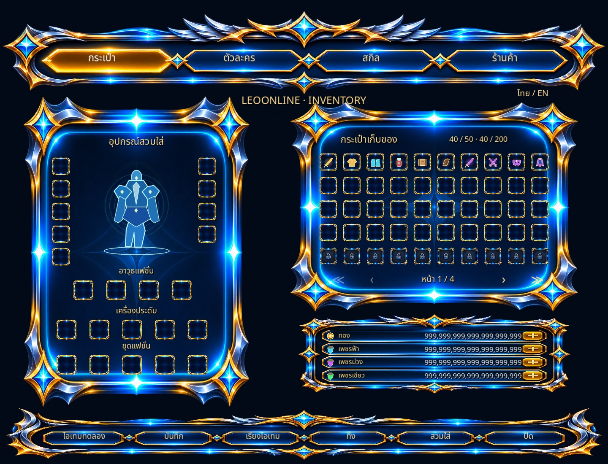
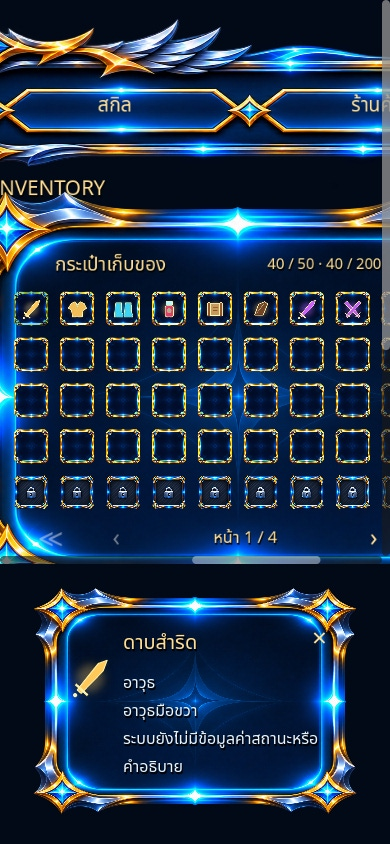

# Inventory UI verification

Godot 4.4.1, PC and mobile browser export. No PNG asset was created, edited, cropped or replaced. All ten files in `assets/ui/approved/` remain byte-for-byte unchanged.

The flattened reference PNG contains six fashion slots and two fashion-weapon boxes. Using that bitmap as the live background cannot produce five clothing slots and four fashion-weapon/mask/cape slots without covering or modifying it. The live UI therefore uses the approved blank frame, navigation bar, action bar, currency panel and individual slot PNGs as separate regions. It preserves the requested group order and original artwork, but is not a pixel-identical copy of the flattened reference.

Implemented:

- 200 stored entries, four pages of 50 (10 × 5), 40 initially unlocked; lock texture is replaced when a slot unlocks.
- Nine equipment, five accessory, five fashion clothing and four separate fashion weapon/mask/cape slots. Empty slots show no fictitious equipped item.
- Separate Thai/English text, existing Noto Sans Thai font, item details sourced from `Store.DATA`. The current database has no stats, descriptions or item levels; the UI states their absence rather than inventing them.
- Tap to inspect equipment, then the existing Equip action becomes Unequip. Inspecting another bag entry no longer silently swaps items.
- All six footer buttons wired; cancellation preserves an item; confirmation deletes the item selected when the dialog opened.
- Save success is reported only after a successful write/flush; exact 21-digit currency handling preserved.
- Mobile opener and scrollable layout keep slot hit targets at least 44 px. Small screens pan the composition; they do not show the entire desktop composition at once. Item details use a separate bottom dock and shrink the scroll viewport instead of covering slots.
- Skill/Shop explicitly unavailable. Existing character silhouette remains a placeholder; this change does not add a character model or skill/shop systems.
- Normal CI/build/deploy workflows no longer run the PNG generator.

Validation before deployment:

- Godot 4.4.1 import and Web export completed.
- `scripts/smoke_test.gd`: 458 checks, zero failures, including viewport-routed button clicks, storage, equip/unequip, trash confirmation, sorting, Thai glyphs, translation, currency cap and save/load.
- Real OpenGL rendering inspected at 1440 × 1100, 390 × 844 and 844 × 390, in both languages, page four, max currency and item-detail states.
- `git diff --check` passed; no asset changes.

Reproduce scene checks with `godot --headless --path . --script scripts/smoke_test.gd`. The test backs up and restores the local save. `scripts/qa_capture.gd` captures rendered views when run with a graphical display, optionally accepting an output directory after `--`.

Live browser limitation: the cloud browser displayed Godot's missing-WebGL2 error before game startup. Interactive browser gameplay is therefore **not verified** here. The actual engine rendered the UI through OpenGL, and the Web export completed, but those checks do not substitute for a browser gameplay pass.

